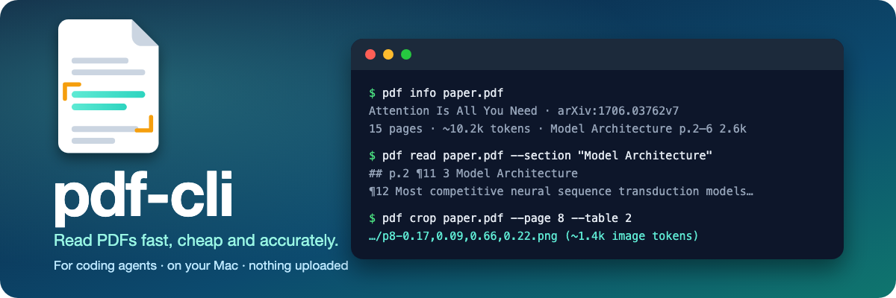

<!-- what-we-build: drafted 2026-10-29 -->
<div align="center">



<br>

[](LICENSE)


[](https://github.com/jinhuang712/pdf-cli/releases)

[English](README.md) · **简体中文**

</div>

## ✨ 它是什么

`pdf` 让 Claude Code 这类编程 agent 在你的 Mac 上读 PDF。每个文件只解析一次，结果存在本机缓存里，agent 要什么就给什么：先给一张地图，再按需给某一节、某几页、某条脚注、某个搜索命中，或者一张表格的截图。

- 🗺️ **先给地图，再给正文。** `pdf info` 给出大纲、每一节有多少 token、图和表的清单，以及哪些页没读好。
- ✂️ **只给要的部分。** 读一节或一段页码；输出到预算就停，并告诉你接着读的命令。
- 🔎 **搜一个 PDF，或搜全部。** 命中所有词的段落排在前面，每条都带页码和位置。
- 🖼️ **表格、公式和图以截图交给 agent。** 凡是不能确定读对的，工具一概不转换：重建出来的单元格可能是错的，却看着像对的。由 agent 自己的模型看图，它写回来的结果会被保存，所以每处只读一次。
- 🚩 **拿不准会说。** 每一页、每一段没读好的内容都会标出来，并给出把那页当图片看的命令。
- 🙈 **不悄悄丢任何东西。** 隐藏文字、页眉页脚、存疑的文字、批注和附件，都在原位留下标记，摘要行里会数出来，并写明显示它们的开关。
- 🔒 **全在本机。** 读取靠 Apple 的 PDFKit 和 OCR。不联网、不下载模型，什么都不会离开你的 Mac。

> [!NOTE]
> **早期版本（0.1.0）。** 在测试过的文件上能用，[plan/GOALS.md](plan/GOALS.md) 里的各项目标仍在测量中。

## 👀 看个例子

输出有删减。论文是 *Attention Is All You Need*。

```console
$ pdf info paper.pdf
Attention Is All You Need · 2024 · arXiv:1706.03762v7
15 pages · 1 column · text layer on 15 pages · ~10.2k tokens
…
Section                                 pages      tokens
  Model Architecture                    p.2–6      2.6k
    Attention                           p.3–5      1.2k
  Why Self-Attention                    p.6–7      806
  Training                              p.7–8      741

$ pdf read paper.pdf --section "Model Architecture" --budget 250
paper.pdf · 15 pages · read p.2–3 · flagged: none · running headers and footers: 1 set aside (show: --show headers)

## p.2

¶11 3 Model Architecture

¶12 Most competitive neural sequence transduction models have an encoder-decoder structure …

$ pdf crop paper.pdf --page 8 --table 2
…/p8-0.17,0.09,0.66,0.22.png  (~1.4k image tokens, 1568×676 px)
p.8 · caption: The Transformer achieves better BLEU scores than previous state-of-the-art models …
```

## 📊 真的省吗？

这是第一次小规模测试，只当作趋势看：让 Claude Haiku 5.5 对同一批问题回答两次，一次用 `pdf`，一次用 Claude Code 内置的 PDF 读取。两种方式答案都对。用 `pdf` 的花费占直接读的比例：

| 问题类型 | 占比 |
|---|---|
| 在 492 页的标准文档里查值、查标题、查脚注 | **约 16%** |
| 同一份文档里大表格的单元格和计数 | 约 55% |
| 15 页论文上的混合问题 | 约 51% |

文件越长省得越多；大表格是省得最少的地方，因为表格要从截图里读。每题只跑了一次，只用了一个模型、两份文件。详情和发现见 [reports/M3.6-first-question-runs.md](reports/M3.6-first-question-runs.md)。

## ⌨️ 命令

| 想做的事 | 命令 |
|---|---|
| 把文件加进库并解析 | `pdf add paper.pdf` |
| 先看一眼：大纲、大小、图表、标记 | `pdf info paper.pdf` |
| 读几页或一节 | `pdf read paper.pdf --page 4-6` · `--section Method` |
| 搜一个文件，或搜读过的所有文件 | `pdf search paper.pdf dropout ablation` · `pdf search dropout ablation` |
| 看图、表、公式或某个区域 | `pdf crop paper.pdf --figure 4` · `--table 2` · `--bbox 0.1,0.4,0.8,0.3` |
| 读脚注，或读引用的参考文献 | `pdf note paper.pdf 7` · `pdf ref paper.pdf 12` |
| 保存 agent 看图读出的结果 | `pdf transcribe paper.pdf --page 8 --table 2` |
| 在存疑词的两种读法里选一个 | `pdf pick paper.pdf p2.7 b` |
| 把某页当扫描件用 OCR 重读 | `pdf reparse scan.pdf --page 3 --step ocr` |
| 把文字、图、脚注和参考文献写成文件 | `pdf dump paper.pdf` |
| 列出或删除库里的内容 | `pdf ls` · `pdf rm paper.pdf` |
| 检查环境、清理空间、设置解析用的内存 | `pdf doctor` · `pdf clean` · `pdf setup` |
| 让 agent 学会这个工具 | `pdf agent-guide --install claude-code` |

每个命令都有 `--help`，都支持 `--json`。退出码：0 完成，2 有些页被标记，3 文件失败，1 无法运行，64 用法错误。每个命令做什么、不做什么，见 [FEATURES.md](FEATURES.md)（英文）。

## 📦 安装

需要 macOS 12 或更新。

**一行命令：** 下载预编译的二进制（Apple 芯片和 Intel 合在一个文件里），校验 SHA-256，把 `pdf` 放进 `~/.local/bin`。再运行一次就是更新。

```bash
curl -fsSL https://raw.githubusercontent.com/jinhuang712/pdf-cli/main/install.sh | bash
```

想手动装，压缩包和校验文件在 [releases 页面](https://github.com/jinhuang712/pdf-cli/releases)。二进制只做了临时签名，没有公证：如果用浏览器下载后 macOS 拒绝打开，运行 `xattr -d com.apple.quarantine pdf`。Intel 那一半没有在 Intel Mac 上跑过。

**或者从源码构建**（需要 Swift 工具链，来自 Xcode 或命令行工具）：

```bash
git clone https://github.com/jinhuang712/pdf-cli.git
cd pdf-cli
swift build -c release
ln -s "$PWD/.build/release/pdf" ~/.local/bin/pdf    # 或放到 PATH 里的任意位置
```

### 🤖 给你的 agent：插件

插件是一份很短的指南（不到 2,000 token），告诉 agent 该跑哪个命令，以及输出里各种标记的含义。下面每一行都会装好插件，`pdf` 还没装的话一并装上；再运行一次就是更新。

```bash
# Claude Code
curl -fsSL https://raw.githubusercontent.com/jinhuang712/pdf-cli/main/install-claude.sh | bash
# Codex
curl -fsSL https://raw.githubusercontent.com/jinhuang712/pdf-cli/main/install-codex.sh | bash
```

新开一个会话后，skill 显示为 `pdf-cli:pdf-cli`。如果 `pdf` 已经装好，也可以用 `pdf agent-guide --install claude-code`，把同一份指南写进 Claude Code 的 skills 目录。

## 💡 需要知道

- **只支持 macOS。** 它建立在 Apple 的 PDF、OCR 和神经网络引擎框架上，这也是它不用上传任何东西的原因。
- **扫描件。** OCR 从 macOS 12 起能读英、中、法、德、意、葡、西语；扫描页的文档结构识别需要 macOS 26，日语和韩语扫描件需要 macOS 13。
- **它不做推理。** 它只返回文字、截图和失败报告，回答问题的是 agent。
- **大表格是截图。** 需要看长表很多行的问题，agent 要看好几张图。见 [FEATURES.md](FEATURES.md) 的 Crop 一节。
- 在 Apple 芯片的 macOS 27 上测试过。

## 📚 文档

下列文档为英文。

| | |
|---|---|
| [PROPOSAL.md](PROPOSAL.md) | 我们为什么做这个？ |
| [PHILOSOPHY.md](PHILOSOPHY.md) | 项目怎么看这个问题？ |
| [DESIGNS.md](DESIGNS.md) | 怎么做的，为什么这样做？各项决定在 [plan/decisions/](plan/decisions/) |
| [FEATURES.md](FEATURES.md) | 每个命令做什么，永远不做什么？ |
| [plan/GOALS.md](plan/GOALS.md) | 我们量什么？（[plan/MEASURE.md](plan/MEASURE.md)：测量怎么设计） |
| [plan/ROADMAP.md](plan/ROADMAP.md) | 什么时候做，做到哪了？（[plan/TODO.md](plan/TODO.md)：零碎待办） |
| [reports/](reports/README.md) | 每个任务的评审和测量发现了什么？ |
| [CHANGELOG.md](CHANGELOG.md) | 每个版本改了什么？ |
| [CLAUDE.md](CLAUDE.md) | 怎么在这个项目里干活，以及项目负责人定下的方向 |

## 📄 许可证

[MIT](LICENSE)
